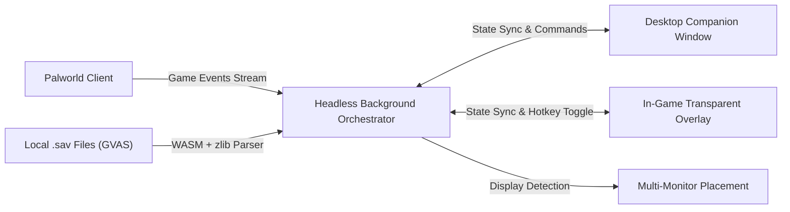

# Palcore — Palworld Base & Radar Companion

> **Local-first Overwolf PC companion for Palworld** — inspect chest inventories, track base Pals, and navigate storage with a live in-game radar without uploading save files to external servers.

[-3178c6?style=flat-square)](#)

> **Availability:** Distributed via the Overwolf App Store *(store link will be added upon listing publication)*.
> **Source Code Notice:** Source code is maintained in a private repository due to commercial Overwolf distribution requirements. Architecture deep-dives and live code walkthroughs are available upon request during technical interviews.

<!--
TODO: Once screenshots / demo GIF are captured, uncomment below and place assets in docs/assets/

-->

---

## Engineering Highlights

Palcore is built as a lightweight, zero-backend desktop & in-game companion engineered to run alongside an Unreal Engine title without hurting frame rates or leaking user data:

- **Client-Side Binary Save Parsing (`WASM` + `zlib`):** Decompresses and parses local Palworld `.sav` (GVAS) binary files directly on the user's PC using WebAssembly and streaming decompression — zero cloud uploads, zero backend infrastructure required.
- **Real-Time Telemetry & Save Alignment:** Combines live game event coordinates with parsed save-world coordinates through a 4-stage radar state machine (`closed` → `lobby` → `searching` → `live`), ensuring accurate live tracking even on newly created worlds before bases or chests exist.
- **Multi-Window & Multi-Monitor Orchestration:** Coordinates a headless background controller, a desktop companion window, and a transparent in-game overlay with state-aware focus takeover/release and automatic second-monitor placement.
- **Production Build & Schema Hygiene:** Strict TypeScript (`noImplicitAny`, `strictNullChecks`), JSON Schema manifest validation (`ajv`), asset verification gates, and automated production manifest sanitization.
- **Internationalization & Onboarding:** Multi-language UI (`en`, `tr`, `de`, `es`, `ja`, `pt-BR`) via `i18next`, DPI-aware responsive layouts, and an interactive spotlight First-Time User Experience (FTUE).

---

## High-Level Architecture

For a detailed breakdown of the technical challenges, state synchronization model, and design trade-offs, see **[docs/architecture.md](./docs/architecture.md)**.

---

## Core Features

| Feature | Description |
| :--- | :--- |
| **Chest Inventory Explorer** | Search items across all base storage containers locally without opening chests one by one in-game. |
| **Base Pal Tracker** | View active base Pals along with work suitability and status read directly from local save data. |
| **Live Base Radar** | Real-time player orientation and chest markers aligned to your base; click any chest marker to inspect its contents. |
| **Non-Intrusive Overlay** | Toggle instantly with a customizable hotkey (default `Ctrl+Shift+G`), minimize to the desktop companion, or auto-park on single-monitor setups. |
| **Local-First Privacy** | Save files and preferences remain strictly on the user's machine. |

---

## Tech Stack

| Layer | Technologies |
| :--- | :--- |
| **Language** | TypeScript 5.8 (`strict`, `noImplicitAny`, `strictNullChecks`) |
| **Runtime / Platform** | Overwolf Native Platform (CEF multi-window WebApp), Game Events API |
| **Binary Parsing** | `ooz-wasm` (WebAssembly Oodle decompression), `pako` (zlib) |
| **Localization** | `i18next` (6 locales: English, Turkish, German, Spanish, Japanese, Portuguese BR) |
| **Bundling & Validation** | Webpack 5, `ajv-cli` (JSON Schema validation), custom packaging & sanitization pipeline |

---

## Documentation & Policies

- [System Architecture & Engineering Case Study](./docs/architecture.md)
- [Release Notes / Changelog](./CHANGELOG.md)
- [Privacy Policy](./PRIVACY.md)
- [Terms of Use (EULA)](./TERMS.md)
- [Third-Party Open Source Notices](./THIRD_PARTY_NOTICES.md)
- [Security Policy](./SECURITY.md)

---

## Bug Reports & Feature Requests

Found an issue or have an idea? Open a ticket via [GitHub Issues](../../issues/new/choose) using the bug report or feature request templates.
