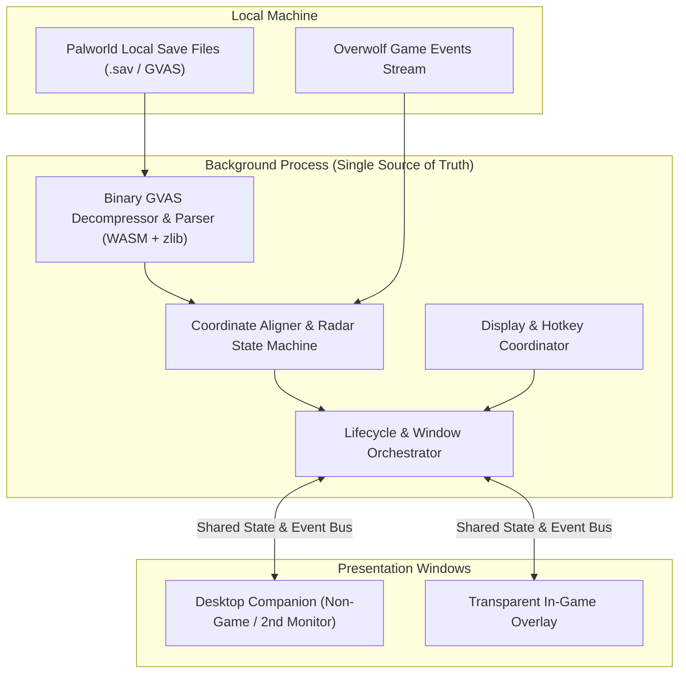

# System Architecture & Engineering Case Study

This document outlines the high-level architecture of **Palcore** and the engineering trade-offs behind its local-first design. Implementation source code is kept private; diagrams and abstractions below reflect the production system topology without proprietary internals.

---

## 1. Multi-Window System Topology

Overwolf applications run independent Chromium Embedded Framework (CEF) window contexts. Running duplicate file parsers or game event listeners in each UI window would waste CPU/memory during gameplay and cause state drift.

To prevent this, Palcore uses a **single-orchestrator architecture**:

### Key Architectural Rules
- **Single Source of Truth:** Only the headless background context owns game event subscriptions, save parsing, and window lifecycle transitions.
- **Thin Presentation Windows:** Desktop and in-game windows act strictly as reactive views subscribing to state updates and forwarding user actions.

---

## 2. Engineering Challenges & Design Decisions

### Challenge 1: Parsing Compressed Unreal GVAS Saves Entirely Client-Side
- **Problem:** Palworld save files use Unreal Engine's binary GVAS format wrapped in Oodle/zlib compression. Uploading multi-megabyte save files to a backend server would add hosting costs, latency, and privacy concerns.
- **Solution:** Built a local-first binary parsing pipeline combining WebAssembly (`ooz-wasm`) and `pako` (`zlib`) inside the client runtime.
- **Trade-off:** Slightly higher client bundle complexity (WASM loading), in exchange for zero server cost, instant offline capability, and strict user privacy.

### Challenge 2: Decoupling Live Radar Tracking from Save Structure
- **Problem:** Early-game saves or newly created worlds may have zero placed chests, which initially caused map/radar views to anchor poorly or show stale coordinates until a base existed.
- **Solution:** Decoupled live player telemetry from static base-chest data and introduced a **4-stage radar state machine** (`closed` → `lobby` → `searching` → `live`).
- **Outcome:** The radar renders meaningful standby/scanning feedback when outside a world and tracks live player orientation continuously from the first second in-game.

### Challenge 3: Non-Intrusive Multi-Monitor & Hotkey Lifecycle
- **Problem:** Players alternate between single-monitor overlay usage and dual-monitor companion setups. Naively calling window restore/move APIs on hotkey toggles can resize or steal focus from an already positioned second-screen desktop window.
- **Solution:** Implemented state-aware window and monitor orchestration that checks current window state and display bounds before repositioning:
  - **Single-monitor:** Parks the desktop window while playing and toggles the transparent overlay via hotkey (`ReleaseOnHidden` focus behavior).
  - **Dual-monitor:** Moves the companion desktop window to a secondary non-game display on game start and restores it cleanly when the game exits, without disturbing user-adjusted window geometry on hotkey presses.

### Challenge 4: Frameless Window Ergonomics & DPI Scaling
- **Problem:** Custom frameless HTML windows with drag regions can conflict with top-edge resizing and interactive onboarding overlays.
- **Solution:** Replaced conflicting CSS drag regions with explicit pointer edge-detection for top/corner resizing and title-bar dragging, paired with DPI-aware minimum dimension enforcement and non-overlapping responsive layouts.

---

## 3. Build, Validation & Release Pipeline

Every release passes automated validation before packaging:

1. **Strict Static Type Checking:** TypeScript strict mode (`noImplicitAny`, `strictNullChecks`).
2. **Contract Validation:** Automated JSON Schema validation (`ajv`) against the official Overwolf manifest schema plus icon/asset integrity checks.
3. **Production Sanitization:** Automated Webpack packaging strips development flags/DevTools from production manifests and produces signed distribution archives for staged QA testing before public release.
